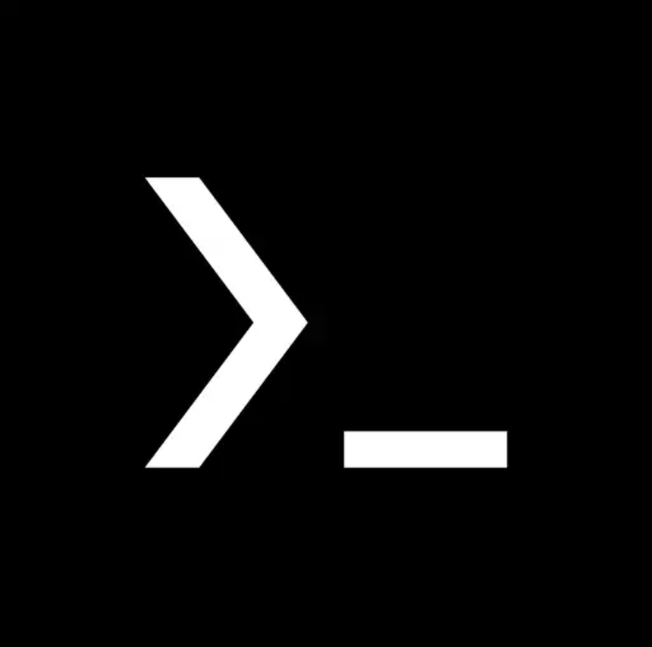
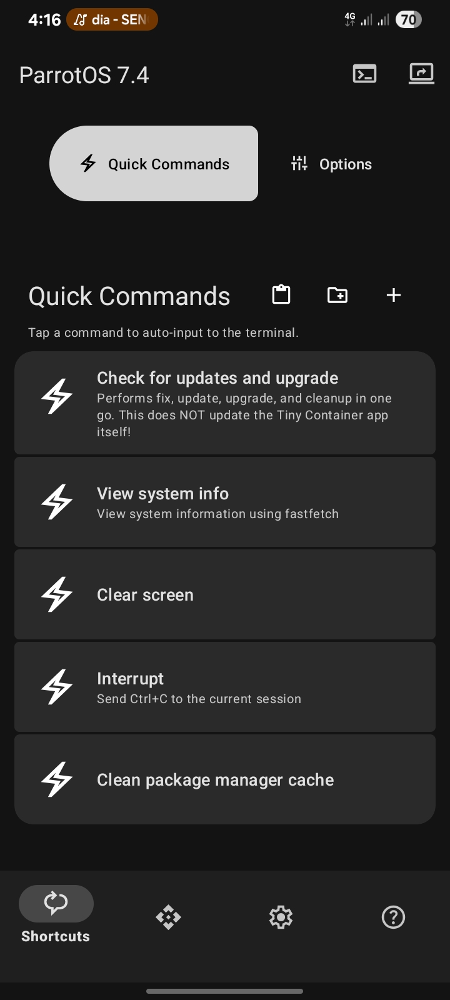
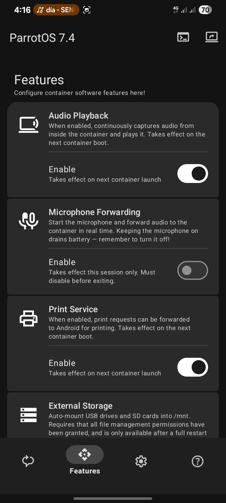
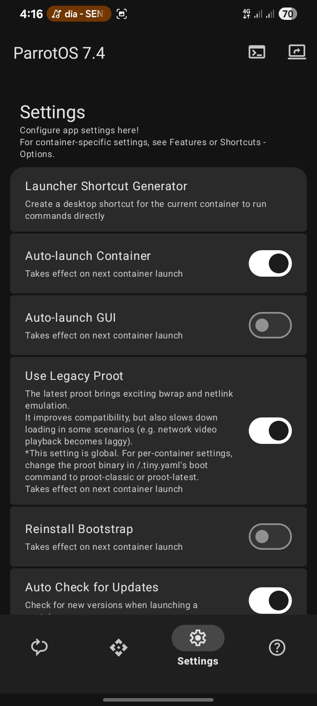
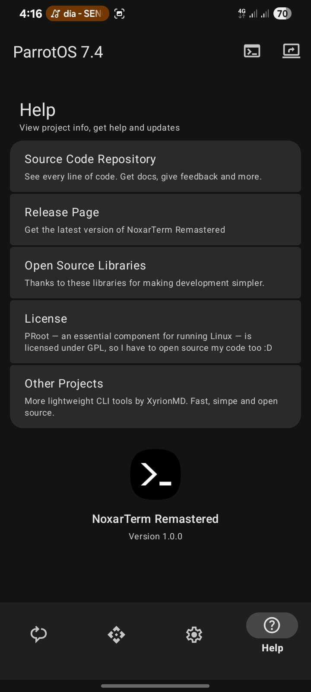
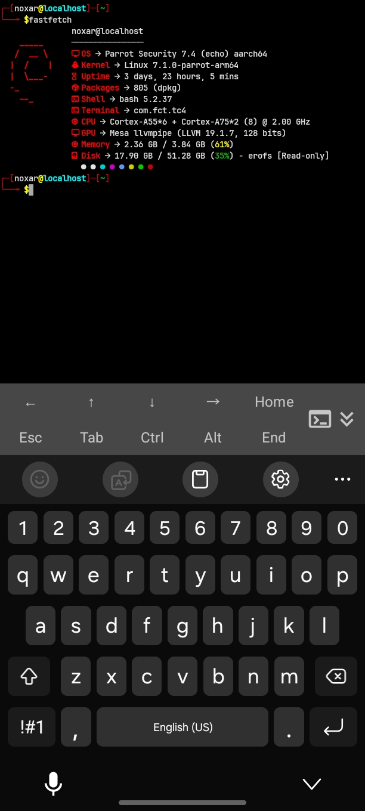
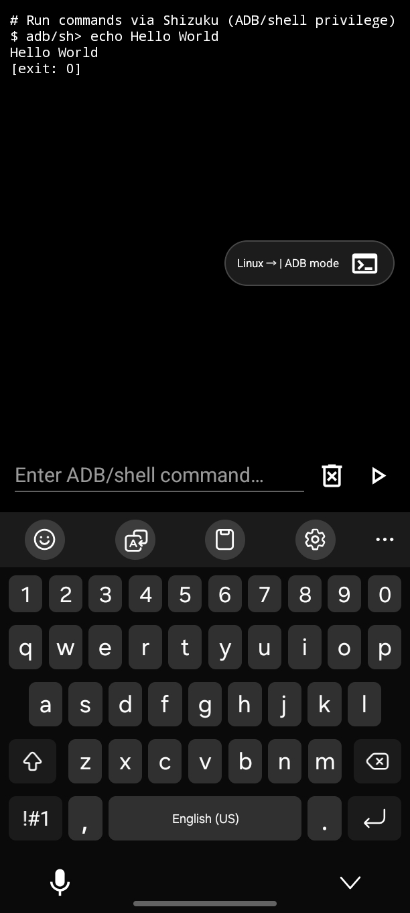

  

<h1 align="center">🛡️ NoxarTerm Remastered</h1>

  
  
  
  
  
  

  <b>NoxarTerm Remastered</b> is a powerful and lightweight Linux environment for Android, designed to bring a full terminal experience to your mobile device.

NoxarTerm Remastered is a specialized fork of [Tiny Container](https://github.com/cateners/tiny_container) by **cateners**, with a completely revamped terminal UI, optimized menu systems, and critical bug fixes for a smoother, more modern experience. Starting with **v1.2.0**, the terminal runs on the [Termux](https://github.com/termux/termux-app) engine instead of the old `terminal-lib` backend.

> [!WARNING]
> **Do NOT install NoxarTerm Remastered together with the original Tiny Container.**
> Both apps use the same package name, data directory, and container paths. Installing them side-by-side will cause conflicts, corrupted containers, and crashes. Please uninstall the original Tiny Container first before installing NoxarTerm Remastered.

---

## ✨ What’s Different in Remastered?

This is not just a rebrand. **v1.2.0 is a major engine upgrade** on top of the revamped UI.

### Terminal engine (new in v1.2.0)

- **Switched from `terminal-lib` (neoterm/Nethunter) to the Termux stack:** the app now bundles its own [`terminal-emulator`](terminal-emulator) and [`terminal-view`](terminal-view) Gradle modules from [termux/termux-app](https://github.com/termux/termux-app) — session/PTY handling and rendering are now done by Termux code, with better escape-sequence compatibility and text selection.
- **Extra keys rewritten:** the reflection hack on the old `ExtraKeysView` is gone. The new `TermuxExtraKeysView` is built for the Termux `TerminalViewClient`, with `Esc`, `Tab`, `Ctrl`/`Alt` toggles, arrow keys, `Home`/`End`, `/`, and an `IME` toggle; `Shift`/`Fn` states are wired through the client as well.
- **Font handling updated for the new engine:** **JetBrains Mono Nerd Font Semi Bold** is still the default, with full **Nerd Font** support so icons and glyphs from `neofetch`, `yazi`, `lazygit`, `starship`, `tmux`, `oh-my-posh`, etc. render correctly (no more `□` / `?` boxes). Sizes are now dp-based, pinch zoom moves in 2 px steps within a 4–256 px range, and the old engine's `42` default is migrated automatically.
- **Session callbacks migrated** to `TerminalSessionClient`, covering text/color changes, clipboard copy, bell/vibration, and signal-9 reporting.
- **Keyboard/overlay fixes:** the terminal stays fullscreen, the IME no longer covers the terminal, floating controls are tapped instead of swiped, and the stale swipe hints were removed.

### Server, audio, and stability

- **Termux:X11 server controls in Settings:** dedicated **Termux X11 Server** item with **Start/Stop** buttons and a live **Running** / **Not running** status. Starting reads the `x11` feature arguments from your container config and launches the bundled Termux:X11 `CmdEntryPointService` — no separate X11 app needed.
- **Restart Audio Server action:** restart the TinyAudio client from Settings when sound stops. TinyAudio also now **auto-reconnects continuously** instead of giving up after 60 seconds.
- **Signal 9 handling improved:** the old full-screen `Signal9Activity` was removed and replaced by a tap-to-open notification. Intentional session kills are no longer misreported as phantom signal-9 crashes.
- **Build updates:** version bumped to **1.2.0** (versionCode 2), NDK pinned to `27.2.12479018`, and Shizuku API/provider dependencies declared explicitly.

If you use a fancy prompt, file manager, or TUI app, you will immediately see the difference.

---

## 🐦 Choose Your Rootfs

> [!NOTE]
> **Starting from v1.1.0, NoxarTerm Remastered no longer provides its own rootfs in Releases.**
> Please download your rootfs from the official Tiny Container images repo instead.

| Rootfs | From | Best For |
| :--- | :--- | :--- |
| **Debian** | [tiny-computer/images](https://github.com/tiny-computer/images/releases) | Stock Debian from Tiny Container, clean & stable |

> Just download the one you want, import it in the app, and you're good to go. No need to reinstall the app to switch.

### Which one should I choose?

- **Pick Debian from Tiny Container** if you want the original clean Debian experience from the upstream project. This is the recommended rootfs for v1.1.0 and later.

---

## ✨ Key Features

- 🐧 **Linux on Android:** Run a full Linux environment directly on your Android device.
- 🧩 **Termux Terminal Engine:** `terminal-emulator` + `terminal-view` bundled locally for better terminal fidelity and rendering.
- 🎨 **Enhanced Terminal UI:** A redesigned terminal interface for better aesthetics and readability.
- ⌨️ **Improved Extra Keys:** A new Termux-compatible extra keys bar with a cleaner layout and more reliable controls.
- 📟 **ADB Terminal (Shizuku):** Run ADB/shell commands from within the app. **Requires Shizuku to be installed, active, and granted permission**; if Shizuku is unavailable or inactive, this feature cannot be used.
- 🖥️ **Termux:X11 Server Control:** Start/stop the in-app X11 server from Settings with live status.
- 🔊 **Audio Recovery:** Manual "Restart Audio Server" action plus continuous TinyAudio auto-reconnect.
- 🔔 **Signal-9 Notifications:** Tap-to-open notification instead of a separate full-screen crash activity.
- 🛠️ **Optimized Menus:** Streamlined and intuitive navigation for faster access to tools.
- 🐛 **Bug Fixes & Patches:** Many stability and usability issues from the original version have been addressed.
- 🚀 **High Performance:** Optimized to run efficiently on mobile hardware.

---

## 📸 Screenshots

Explore the new look and feel of NoxarTerm Remastered:

| | | |
| :---: | :---: | :---: |
|  |  |  |
|  |  |  |

---

## 🚀 Getting Started

### Installation

1. **Uninstall the original Tiny Container** if you have it installed. Do not keep both apps, they will conflict.
2. Download the latest `.apk` from the [Releases](../../releases) section.
3. Enable **"Install from Unknown Sources"** in your Android device settings.
4. Install the APK and launch **NoxarTerm Remastered**.
5. **Pick your rootfs:** Download Debian from Tiny Container, then import it via the import button in the app.

### Installing a Rootfs

You can get a rootfs from:

- **Debian (from Tiny Container):** [https://github.com/tiny-computer/images/releases](https://github.com/tiny-computer/images/releases) — stock Debian images from the upstream project.

Then import it in the app via the **Import** button.

> [!CAUTION]
> **Only install rootfs from trusted sources!**
> A rootfs runs with full Linux privileges inside your container. Do NOT download rootfs from random links, random Telegram groups, random YouTube descriptions, or strangers. A malicious rootfs can steal your files, credentials, and data.
> Stick to the official [tiny-computer/images](https://github.com/tiny-computer/images/releases) releases only.

### How It Works

1. **Install the app and open it — no manual steps required.** After a 5-minute initialization, you'll be at the desktop.
2. **Installation commands for common software are already prepared for you.** Just tap, and the app handles the rest.
3. **The UI is designed to be as friendly as possible, not just "good enough to have a UI".** AI-powered translations are available in many languages. Even RTL layout is supported!
   - (Admittedly, I don't use RTL myself and can't verify the AI translations, so no guarantees on accuracy! But better to have it than not, right?)
4. **Containers and configurations can be freely shared!**
5. **Cutting-edge features from the Termux community are ready to go!** No need to learn how to install containers, start graphical sessions, configure audio, and all that tedious stuff. The following features work out of the box:
   - Import containers via the import button, with graphical session startup included (if supported);
   - Built-in AVNC and Termux:X11 frontends — no extra app installation needed;
   - Audio and microphone forwarding;
   - virglrenderer and turnip+zink graphics acceleration...
6. **Features only possible in a single app!**
   - Audio and VNC transmitted over unix sockets, bypassing the network stack;
   - Browse container files via the SAF file manager;
   - Add .desktop files or even arbitrary commands as shortcuts to your Android launcher!
7. **Won't conflict with Termux!**

---

> **Tip:**
> - Tap the floating controls to toggle the extra keys bar (Linux terminal) or return from ADB Terminal to the Linux terminal.
> - If Android kills the container process (signal 9), tap the **Terminal killed (signal 9)** notification to jump back into NoxarTerm.

## 📜 Credits & Origin

NoxarTerm Remastered is proudly built upon the foundation of **Tiny Container**.

- **Original Project:** [Tiny Container](https://github.com/cateners/tiny_container) by **cateners**.
- **NoxarTerm Remastered Fork:** Developed to enhance the terminal UI and overall user experience.
- **Terminal Engine:** [Termux](https://github.com/termux/termux-app) `terminal-emulator` and `terminal-view`, vendored from commit `8629e63`, with the extra keys view adapted for NoxarTerm.
- **Debian Images:** Debian rootfs images are provided by the upstream project at [tiny-computer/images](https://github.com/tiny-computer/images/releases).

---

## ⚖️ License

NoxarTerm Remastered is licensed under the **GNU General Public License v3.0 (GPL-3.0)**. See [COPYING](COPYING) and [app/src/main/assets/gpl_v3.txt](app/src/main/assets/gpl_v3.txt) for the full license text. The original Tiny Container copyright and license notices are still present in the source headers and remain in effect here.

| Component | Origin | License |
| :--- | :--- | :--- |
| Tiny Container (base project, © 2026 Caten Hu) | [cateners/tiny_container](https://github.com/cateners/tiny_container) | GPL-3.0 (its headers say GPL-3.0 **or later**); NoxarTerm is distributed under GPL-3.0 |
| `terminal-emulator` and `terminal-view` | [termux/termux-app](https://github.com/termux/termux-app), commit `8629e63` | GPL-3.0 (Termux); based on [jackpal/Android-Terminal-Emulator](https://github.com/jackpal/Android-Terminal-Emulator), Apache-2.0 |
| Termux:X11 frontend (bundled via `termux-x11`) | [termux/termux-x11](https://github.com/termux/termux-x11) | GPL-3.0 |
| Shizuku API/provider (ADB Terminal) | [RikkaApps/Shizuku](https://github.com/RikkaApps/Shizuku) | Apache-2.0 |

The upstream sources are kept in [`external/termux-app`](external/termux-app) (including its [LICENSE.md](external/termux-app/LICENSE.md)), and are compiled into the local `:terminal-emulator` and `:terminal-view` modules. Termux notes that the terminal libraries contain code from *Terminal Emulator for Android* under **Apache-2.0**, with Termux's own changes under **GPL-3.0**; Apache-2.0 code is GPL-compatible, and the combined NoxarTerm work is distributed under **GPL-3.0**.

### For forks of NoxarTerm

Because the whole work is GPL-3.0, any fork (including forks of forks 🗿) must keep the GPL-3.0 license, the `COPYING` file, and the copyright/license notices of Tiny Container, Termux, and the other components above. Please preserve the credits instead of replacing them with your own name only.

Other bundled libraries keep their respective licenses and are listed in the app under **Help → Open Source Libraries**, sourced from [open_source_libraries.json](app/src/main/assets/open_source_libraries.json).

> **Note on rootfs:** No custom Linux license is needed for this project. The rootfs provided by Tiny Container follow their respective upstream open-source licenses. NoxarTerm Remastered itself is licensed under GPL-3.0 as stated above.
