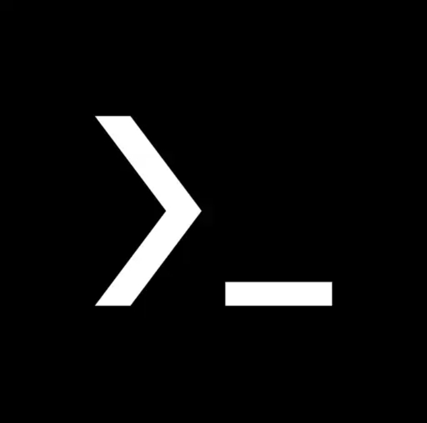
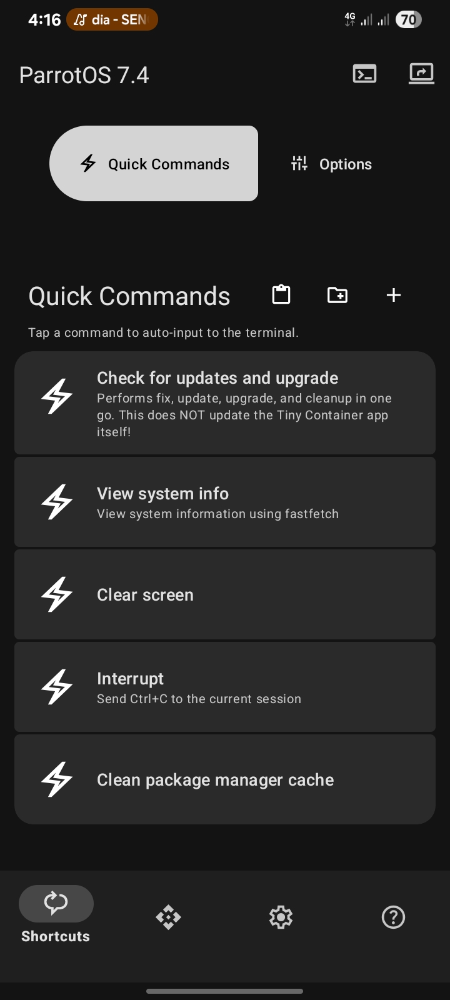
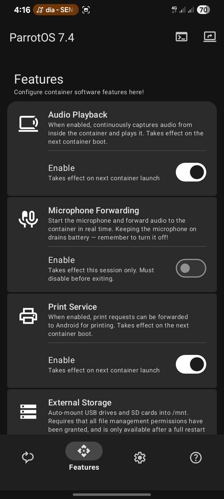
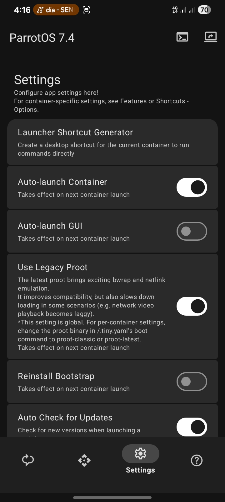
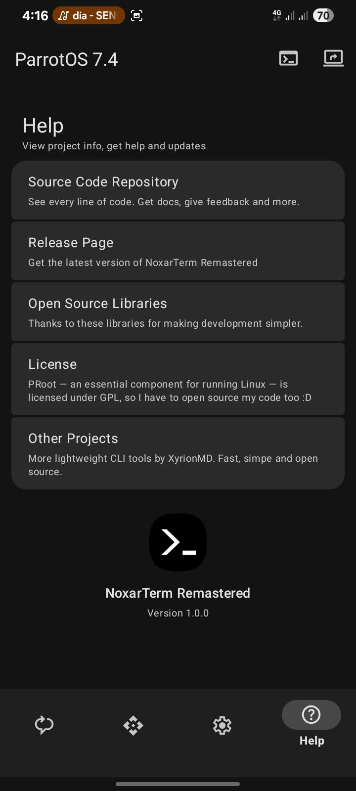
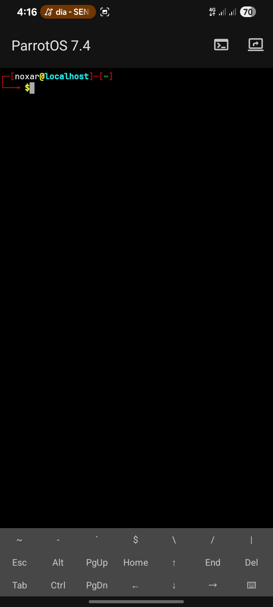
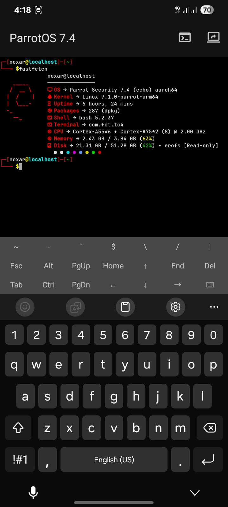

# 🛡️ NoxarTerm Remastered

[[License: GPL v3](https://img.shields.io/badge/License-GPLv3-blue.svg)](COPYING)
[[Platform: Android](https://img.shields.io/badge/Platform-Android-3DDC84?logo=android&logoColor=white)](https://www.android.com)
[[Fork of Tiny Container](https://img.shields.io/badge/Fork%20of-Tiny%20Container-orange)](https://github.com/cateners/tiny_container)
[[Version](https://img.shields.io/badge/Version-Remastered-purple)](../../releases)
[[Linux](https://img.shields.io/badge/Linux-Terminal-black?logo=linux&logoColor=white)](#)

**NoxarTerm Remastered** is a powerful and lightweight Linux environment for Android, designed to bring a full terminal experience to your mobile device.

NoxarTerm Remastered is a specialized fork of [Tiny Container](https://github.com/cateners/tiny_container) by **cateners**, with a completely revamped terminal UI, optimized menu systems, and critical bug fixes for a smoother, more modern experience.

> [!WARNING]
> **Do NOT install NoxarTerm Remastered together with the original Tiny Container.**
> Both apps use the same package name, data directory, and container paths. Installing them side-by-side will cause conflicts, corrupted containers, and crashes. Please uninstall the original Tiny Container first before installing NoxarTerm Remastered.

---

## ✨ What’s Different in Remastered?

This is not just a rebrand. The biggest change is in the terminal itself:

- **JetBrains Mono Nerd Font Semi Bold** as the default terminal font.
- Full **Nerd Font** support, so icons, glyphs, and symbols from tools like `neofetch`, `yazi`, `lazygit`, `starship`, `tmux`, `oh-my-posh`, and other modern CLI tools render correctly, no more `□` / `?` boxes.
- Bolder, sharper, and more readable text for long terminal sessions.
- Revamped terminal UI and optimized menus for a cleaner, more modern look.

If you use a fancy prompt, file manager, or TUI app, you will immediately see the difference.

---

## 🐦 Choose Your Rootfs

The app is the same, you just pick which rootfs you want to import. You are free to choose:

| Rootfs | From | Best For |
| :--- | :--- | :--- |
| **Parrot + Openbox** | This repo (Releases) | Desktop experience, GUI apps, Parrot tools |
| **Parrot CLI Only** | This repo (Releases) | Lightweight, fast, terminal purist |
| **Debian** | [tiny-computer/images](https://github.com/tiny-computer/images/releases) | Stock Debian from Tiny Container, clean & stable |

The Parrot rootfs here are **not heavily customized**, they are just stock Parrot with a few useful apps **preinstalled** so you don't have to set everything up from scratch.

> Just download the one you want, import it in the app, and you're good to go. No need to reinstall the app to switch.

### Which one should I choose?

- **Pick Parrot + Openbox** if you want Parrot + desktop, GUI apps, and hacking tools ready to go.
- **Pick Parrot CLI Only** if you want Parrot but the lightest and fastest experience. Best match for the new Nerd Font terminal.
- **Pick Debian from Tiny Container** if you want the original clean Debian experience from the upstream project.

---

## ✨ Key Features

- 🐧 **Linux on Android:** Run a full Linux environment directly on your Android device.
- 🎨 **Enhanced Terminal UI:** A redesigned terminal interface for better aesthetics and readability.
- 🛠️ **Optimized Menus:** Streamlined and intuitive navigation for faster access to tools.
- 🐛 **Bug Fixes & Patches:** Many stability and usability issues from the original version have been addressed.
- 🚀 **High Performance:** Optimized to run efficiently on mobile hardware.

---

## 📸 Screenshots

Explore the new look and feel of NoxarTerm Remastered:

| | | |
| :---: | :---: | :---: |
|  |  |  |
|  |  |  |

---

## 🚀 Getting Started

### Installation

1. **Uninstall the original Tiny Container** if you have it installed. Do not keep both apps, they will conflict.
2. Download the latest `.apk` from the [Releases](../../releases) section.
3. Enable **"Install from Unknown Sources"** in your Android device settings.
4. Install the APK and launch **NoxarTerm Remastered**.
5. **Pick your rootfs:** Download Parrot from this repo, or Debian from Tiny Container, then import it via the import button in the app.

### Installing a Rootfs

You can get a rootfs from:

- **Parrot (from me):** The **Releases** page of this repo — Parrot Openbox or Parrot CLI Only, with some apps preinstalled.
- **Debian (from Tiny Container):** [https://github.com/tiny-computer/images/releases](https://github.com/tiny-computer/images/releases) — stock Debian images from the upstream project.

Then import it in the app via the **Import** button.

> [!CAUTION]
> **Only install rootfs from trusted sources!**
> A rootfs runs with full Linux privileges inside your container. Do NOT download rootfs from random links, random Telegram groups, random YouTube descriptions, or strangers. A malicious rootfs can steal your files, credentials, and data.
> Stick to this repo and the official [tiny-computer/images](https://github.com/tiny-computer/images/releases) releases only.

### How It Works

1. **Install the app and open it — no manual steps required.** After a 5-minute initialization, you'll be at the desktop.
2. **Installation commands for common software are already prepared for you.** Just tap, and the app handles the rest.
3. **The UI is designed to be as friendly as possible, not just "good enough to have a UI".** AI-powered translations are available in many languages. Even RTL layout is supported!
   - (Admittedly, I don't use RTL myself and can't verify the AI translations, so no guarantees on accuracy! But better to have it than not, right?)
4. **Containers and configurations can be freely shared!**
5. **Cutting-edge features from the Termux community are ready to go!** No need to learn how to install containers, start graphical sessions, configure audio, and all that tedious stuff. The following features work out of the box:
   - Import containers via the import button, with graphical session startup included (if supported);
   - Built-in AVNC and Termux:X11 frontends — no extra app installation needed;
   - Audio and microphone forwarding;
   - virglrenderer and turnip+zink graphics acceleration...
6. **Features only possible in a single app!**
   - Audio and VNC transmitted over unix sockets, bypassing the network stack;
   - Browse container files via the SAF file manager;
   - Add .desktop files or even arbitrary commands as shortcuts to your Android launcher!
7. **Won't conflict with Termux!**

---

## 📜 Credits & Origin

NoxarTerm Remastered is proudly built upon the foundation of **Tiny Container**.

- **Original Project:** [Tiny Container](https://github.com/cateners/tiny_container) by **cateners**.
- **NoxarTerm Remastered Fork:** Developed to enhance the terminal UI and overall user experience.
- **Parrot OS:** Parrot OS is a third-party Linux distribution used as the container base in the provided rootfs. It is not owned or created by this project.
- **Debian Images:** Debian rootfs images are provided by the upstream project at [tiny-computer/images](https://github.com/tiny-computer/images/releases).

---

## ⚖️ License

This project is licensed under the **GNU General Public License v3.0 (GPL-3.0)**.

See the [COPYING](COPYING) file in the root directory for the full license text.

NoxarTerm Remastered is a fork of Tiny Container, and as such, it remains under the same GPL-3.0 license as the original project.

> **Note on rootfs:** No custom Linux license is needed for this project. The Parrot rootfs provided are stock Parrot with some apps preinstalled, and they follow their respective upstream open-source licenses. NoxarTerm Remastered itself is licensed under GPL-3.0 as stated above.
